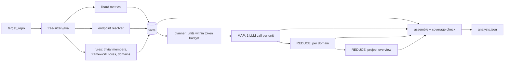

# Documentation

## Contents

1. [Results](#results)
2. [Approach](#approach)
3. [Design decisions](#design-decisions)
4. [Token management](#token-management)
5. [Output format](#output-format)
6. [Reliability](#reliability)
7. [Model choice](#model-choice)
8. [Evaluation](#evaluation)
9. [Best practices](#best-practices)
10. [Assumptions and limitations](#assumptions-and-limitations)
11. [Configuration](#configuration)
12. [Future work](#future-work)

## Results

Full run on 2026-10-19 with `gemini-3.5-flash-lite` (free tier), target commit `62873f7`:

- **Coverage:** 188/188 files, 248/248 classes, **608/608 methods described** (278 by the LLM, 330 by rules), 0 failures.
- **Extracted:** 70 endpoints, 11 domains, 161 key methods, 100 findings.
- **Cost:** 124 LLM calls (123 planned), 294,867 input / 51,287 output tokens, ~8 minutes.
- **Resilience:** 7 rate-limit errors handled by backoff. 1 invalid response was rejected and corrected on retry.
- **Quality:** 10/12 sampled method descriptions correct; 32/43 bug findings valid (74%). See [Evaluation](#evaluation).

The committed `analysis.json` was re-assembled from the response cache after two output-only fixes (the `key_methods` index, and replacing a leaked internal prompt key with the method name). That's why its `metadata.usage` shows 0 live calls and 123 cache hits, plus the tokens those cached responses originally cost.

## Approach

**Facts are extracted, interpretation is generated.** Anything checkable comes from parsing. The LLM only writes descriptions, summaries and findings, and every LLM-written field is labeled (`description_source`, `summary_source`, `source`).

1. **Read.**
   - `inventory.py` classifies files. `java_parser.py` (tree-sitter) extracts types, methods, generics, annotations and line ranges.
   - `metrics.py` (lizard) measures each method.
   - `endpoints.py` resolves routes as context-path + class mapping + method mapping.
2. **Filter** (`deterministic.py`). The LLM is skipped for:
   - trivial members (getters/setters, `equals`/`hashCode`/`toString`, field-assigning constructors, one-line delegations), which get templated descriptions;
   - abstract members whose behavior is defined elsewhere (MapStruct mappings, Spring Data derived queries).

   Lombok/MapStruct-generated and Spring Data-inherited methods are recorded as `framework_notes`, never invented. This removes 330 of 608 methods from the LLM workload.
3. **Plan** (`chunking.py`). One unit per class, small classes packed, large classes split. Every unit fits the token budget.
4. **Map** (`analyze.py`, `llm.py`). Structured output keyed by ids we supply: a class summary, a description per method, and findings with line numbers.
5. **Reduce.** Class summaries become domain summaries, and those become the project overview. The overview also receives the build files, the config (secrets masked) and the README, which is treated as a claim to check against the code.
6. **Assemble** (`assemble.py`). Facts and LLM text are joined by id. The run fails if any method is missing or duplicated.

## Design decisions

- **The LLM never produces structure.** It only adds text to ids we supply. A parser can't skip a method or misquote a signature, so the output can be verified.
- **One class per call, small classes packed.**
  - A class is the right context for describing its methods.
  - Small, simple classes (≤1,500 tokens, max complexity ≤5) from the same package share a call, up to 8 per call.
  - Each class must come back exactly once. A class missing from a pack's answer is retried on its own.
- **Not one big prompt, RAG or agents.** The goal is *exhaustive* coverage.
  - The repo is ~130k tokens, and one prompt asking for all 608 methods is unreliable and can't be checked.
  - RAG retrieves what's relevant to a question, not everything.
  - Agents decide for themselves what to read.
  - A fixed plan plus map-reduce covers every method exactly once, provably.
- **LangChain is used narrowly:**
  - a provider-neutral chat model;
  - `with_structured_output` (JSON-schema decoding into Pydantic models);
  - provider-neutral error types;
  - native token counting.

  Orchestration is plain Python, testable with a fake model.
- **tree-sitter + lizard.** tree-sitter is an error-tolerant parser with exact positions. lizard is a standard complexity tool, run on each method separately because its whole-file Java parsing drops functions in some files.

## Token management

Budget per request: `input_limit = 32,000 − 12,000 output reserve − 10% margin = 16,800 tokens`.

- **Counting.** A conservative local estimate (`chars / 3`) keeps plans deterministic and offline. Gemini's `count_tokens` (`estimate --native-count`) confirms it: the worst unit came in at 0.85 of its estimate.
- **Context.** Each class is sent with the signatures of the project types it references, capped at 2,000 tokens. This context is dropped first if a class is over budget.
- **Splitting.** An oversized class is split at method boundaries. Each part repeats a skeleton of the class (package, imports, fields, one line per method), and a single oversized method is cut into labeled line segments. Tests assert that no line is lost. None was needed for this repo; `--request-tokens 8000` demonstrates it.
- **Reduce steps are budgeted too.** They read summaries, not code.
- **Nothing is ever truncated.** Anything that can't fit is reported in `coverage.units_failed`.

## Output format

`output/analysis.json` (schema: `output/analysis.schema.json`):

| Section | Content |
|---|---|
| `metadata` | Repo, commit SHA, timestamp, schema/prompt versions, model, applied temperature, token budget, usage |
| `project_overview` | Purpose, functionality, architecture, technologies, cross-cutting concerns |
| `key_methods` | Reading list: endpoint handlers (with routes), `@Service` APIs, custom `@Repository` queries, complex methods |
| `endpoints` | HTTP method, full path, controller, handler, file:line, security |
| `domains` | Summary per functional area, with its classes and endpoints |
| `classes[].methods[]` | Signature, annotations, parameters, return type, lines, `trivial`, complexity, `description` + `description_source` |
| `complexity_summary` | Averages, maxima, bands, top complex methods (boilerplate listed separately) |
| `findings[]` | Category, severity, title, detail, evidence (file + lines), `source` (`llm` / `deterministic`) |
| `coverage` | Files analyzed/skipped (with reasons), totals, packs, splits, failures, rejected findings |

**Complexity.** Cyclomatic complexity (McCabe) and NLOC are measured by lizard. Bands: low < 6, moderate 6–10, high 11–20, very high 21+. Hand-written `equals()` methods are the most complex code here (up to 16), so they're reported apart from business logic.

**Finding checks.** Evidence must cite real lines of a file the model saw, and LLM duplicates of deterministic findings are dropped. Rejections are listed in `coverage.findings_dropped`.

## Reliability

- **Cache.** Each response is saved as it arrives, under a hash of the prompt version, model, temperature, schema and prompt. Re-runs replay instantly, and interrupted runs resume.
- **Rate limits.** Concurrency 1 by default. 429s and server errors back off exponentially, honoring Gemini's suggested delay. A daily-quota error stops the run with the resume command. Auth or unknown-model errors fail fast.
- **Invalid output.** A response with bad JSON or wrong or missing ids is retried up to 3 times with the error attached, then reported as failed. Nothing is fabricated.
- **Reproducibility.** Versioned prompts, a deterministic plan, and the commit SHA and applied temperature in metadata. Exact replay comes from the cache.

## Model choice

Gemini 3.8 Flash was the plan, but its free tier allows only 20 requests/day, and the full run needs ~124. **Gemini 3.5 Flash-Lite** has its own quota, and the full run completed within it.

On a 5-class sample both models described methods equally accurately (6/6), but Flash-Lite found fewer issues (0 vs 4 valid findings). The model is one config value. Flash-Lite ignores temperature, so the analyzer doesn't send it, and the metadata records `temperature: null` with a note.

## Evaluation

Manual review against the source. Paths are under `src/main/java/com/example/app/`.

**12 method descriptions** across 8 domains, chosen as the most complex non-trivial methods plus the longest service and repository logic:

| Method (lines) | Verdict |
|---|---|
| `common/util/ExpressionUtils.betweenExpression` (33–43) | ✅ |
| `services/catalog/controller/ActorController.getActorFilmList` (90–110) | ✅ |
| `services/catalog/controller/FilmController.getFilmList` (38–52) | ✅ |
| `services/catalog/domain/serializer/LocalDateYearSerializer.serialize` (36–49) | ✅ |
| `common/security/JwtAuthenticationProvider.authenticate` (19–36) | ⚠️ omits the `return null` path |
| `services/location/domain/converter/GeometryConverter.convertToEntityAttribute` (21–33) | ❌ says it returns null on a parse error; it throws |
| `services/rental/service/RentalServiceImpl.rentDvd` (63–97) | ✅ |
| `services/rental/service/RentalServiceImpl.returnDvd` (99–120) | ✅ |
| `services/store/repository/custom/CustomStoreRepositoryImpl.findStoreDetail` (48–73) | ⚠️ omits the joins |
| `services/payment/service/PaymentServiceImpl.createPayment` (55–71) | ✅ |
| `services/staff/repository/custom/CustomStaffRepositoryImpl.findStaffDetailsById` (30–34) | ✅ |
| `services/customer/repository/custom/CustomCustomerRepositoryImpl.findAllCustomerRentalListByIdWithCondition` (86–100) | ❌ describes the intended status filter; `RENTED` actually selects returned rentals |

**10/12 correct (8 complete).** Both errors describe the intent rather than the edge behavior, and in both cases a finding on the same class states the real behavior.

**Findings.** All 43 medium/high `potential_bug` findings were reviewed: **32 valid (74%).**
- **Valid examples:** all 8 `Optional.of(query.fetchFirst())` NPE risks, foreign-key updates silently not persisted (`updatable = false`), an assembler passing the wrong class to `super`, a `String` compared with `==`, an inverted status filter.
- **False positives:** 6 of the 11 are one misconception, that `==` on an enum is unsafe. 3 of the 7 `high` ratings are overstated.

## Best practices

- Token limits are guaranteed by the planner, and nothing is truncated.
- Schema-constrained output, re-validated locally. A versioned output schema and a `validate` command.
- Facts and LLM text are kept separate and labeled. Findings must cite real lines.
- No fabrication or silent loss: failures are reported, and a coverage assertion guards the output.
- Efficiency: rules handle trivial code, small classes share calls, responses are cached, and reduce steps read summaries.
- **Security:**
  - The API key lives only in the gitignored `.env`.
  - Config secrets are masked before reaching the LLM.
  - Code comments are treated as data.
  - The target repo is read-only.
- 43 offline tests, including the full pipeline with a fake chat model.

## Assumptions and limitations

**Assumptions**
- Only `src/main/java` is analyzed. Tests are listed, not described.
- Domains follow the package convention `com.example.app.services.<domain>`.
- The project README is a claim. Mismatches with the code are reported as findings.
- Key methods are chosen by rules: endpoint handlers, service APIs, custom queries and complex methods. Every method is still described under `classes`.

**Limitations**
- No call graph or full symbol resolution. A description is based on its class plus the signatures of the types it references.
- Generated code (Lombok, MapStruct, Querydsl) and database objects (views, procedures) aren't analyzed.
- LLM accuracy is measured, not guaranteed. Flash-Lite favors breadth over depth.
- The Gemini free tier may use prompts to improve Google's products. Use a paid tier for private code.

## Configuration

| Setting (`.env`) | Default | CLI flag |
|---|---|---|
| `LLM_PROVIDER` | `google_genai` (`anthropic` optional: `uv sync --extra anthropic`) | `--provider` |
| `LLM_MODEL` | `gemini-3.5-flash-lite` | `--model` |
| `LLM_TEMPERATURE` | `0` | |
| `LLM_CONCURRENCY` | `1` | `--concurrency` |

Other flags: `--max-classes`, `--request-tokens`, `--output-reserve`, `--no-cache`. On Windows, if Smart App Control blocks the `.exe` shim, use `uv run python -m codebase_analyzer <command>`.

## Future work

- Incremental runs that re-analyze only the classes changed since the last commit.
- A RAG Q&A layer over `analysis.json`.
- Local models for private code.
- JavaParser symbol resolution for a real call graph.
