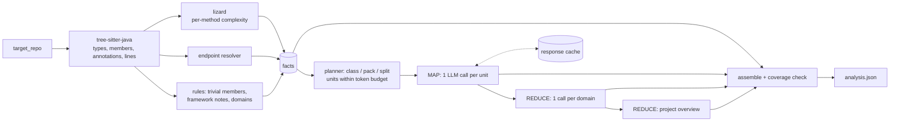

# codebase-analyzer

Analyzes [codejsha/spring-rest-sakila](https://github.com/codejsha/spring-rest-sakila), a Spring Boot 3 / Java 17 REST API over MySQL's Sakila DVD-rental database, with an LLM through LangChain, within per-request token limits. The output is one structured JSON document:

- project overview
- key methods, and every method's signature and description
- REST endpoints and functional domains
- complexity metrics
- findings with file/line evidence

| Deliverable | Location |
|---|---|
| Source code | `src/codebase_analyzer/` (tests in `tests/`) |
| Structured output from a real run | [`output/analysis.json`](output/analysis.json) |
| JSON Schema of that output | [`output/analysis.schema.json`](output/analysis.schema.json) |

**Core idea: facts are extracted, interpretation is generated.** Signatures, annotations, line ranges, endpoints, complexity and domain grouping come from deterministic parsing. The LLM only writes descriptions, summaries and findings about code it was shown, and every LLM-written field is labeled as such (`description_source`, `summary_source`, `source`).

## Results

Live run on 2026-10-19 with `gemini-3.5-flash-lite` (free tier), target commit `62873f7`:

| | |
|---|---|
| Coverage | 188/188 source files, 248/248 classes, **608/608 methods described** (278 by the LLM, 330 by rules), 0 failed units |
| Extracted | 70 endpoints, 11 domains, 161 key methods, 100 findings |
| Cost | 124 LLM calls (123 planned), 294,867 input / 51,287 output tokens, ~8 minutes |
| Resilience | 7 rate-limit errors absorbed by backoff; 1 invalid response rejected by validation and corrected on retry |
| Quality (manual review) | Method descriptions 10/12 correct; LLM bug findings 32/43 valid (74%). See [Evaluation](#evaluation). |

The committed `analysis.json` was re-assembled from the response cache after two output-only fixes (the `key_methods` index, and mapping a leaked prompt key back to a method name). That's why its `metadata.usage` shows 0 live calls, 123 cache hits, and the tokens those cached responses originally cost. A diff against the live output differs in that one finding's text only.

## Quick start

Requires Python 3.11+, [uv](https://docs.astral.sh/uv/) and git. The Spring app is never built or run, so no Java or MySQL is needed.

```bash
uv sync
git -c core.longpaths=true clone https://github.com/codejsha/spring-rest-sakila target_repo
git -C target_repo checkout 62873f7bb8a06681f299f8bd209cb88089e9be04   # the commit analyzed in output/
cp .env.example .env    # Windows: Copy-Item .env.example .env
```

Put a Gemini API key in `.env` (`GOOGLE_API_KEY=...`). Keys are free at <https://aistudio.google.com/apikey>. `.env` and `target_repo/` are gitignored, and the key is never logged or written to output.

```bash
uv run codebase-analyzer estimate --repo ./target_repo                     # plan, calls and tokens; no LLM calls
uv run codebase-analyzer analyze  --repo ./target_repo --max-classes 5 --output output/smoke.json
uv run codebase-analyzer analyze  --repo ./target_repo --output output/analysis.json
uv run codebase-analyzer validate output/analysis.json --repo ./target_repo  # schema + "every method present" check
uv run pytest                                                               # 43 tests, no network
```

Settings live in `.env` or on the command line:

| Setting | Default | CLI flag |
|---|---|---|
| `LLM_PROVIDER` | `google_genai`; `anthropic` is optional via `uv sync --extra anthropic` | `--provider` |
| `LLM_MODEL` | `gemini-3.5-flash-lite` | `--model` |
| `LLM_TEMPERATURE` | `0` | |
| `LLM_CONCURRENCY` | `1` | `--concurrency` |

Other flags: `--request-tokens`, `--output-reserve`, `--no-cache`. If Windows Smart App Control blocks the generated `.exe` shim, use `uv run python -m codebase_analyzer <command> ...`.

## How it works



1. **Read.**
   - `inventory.py` classifies files: `src/main/java` is analyzed, build and config files and the README are context, and tests are only listed.
   - `java_parser.py` (tree-sitter) extracts every type and member with generics, annotations and exact line ranges.
   - `metrics.py` (lizard) measures each method.
   - `endpoints.py` resolves routes as context-path + class mapping + method mapping.
2. **Decide what needs an LLM** (`deterministic.py`). Trivial members (getters, setters, `equals`/`hashCode`/`toString`, field-assigning constructors, one-line delegations) get templated descriptions. So do abstract members defined elsewhere (MapStruct mappings, Spring Data derived queries). Lombok-generated, MapStruct-generated and Spring Data-inherited methods are recorded as `framework_notes` and never invented. This removes 330 of 608 methods from the LLM workload.
3. **Plan units within the token budget** (`chunking.py`). One call per class, small classes packed together, and oversized classes split (see *Token management*).
4. **Map** (`analyze.py`, `llm.py`). Each unit returns structured output keyed by ids we supply: a class summary, one description per requested method, and findings citing line numbers.
5. **Reduce.** Class summaries become domain summaries, and those become the project overview. The project step also receives the build files, the config (secrets masked) and the README. The README is treated as a claim and checked against the extracted facts.
6. **Assemble** (`assemble.py`). Facts and LLM text are joined by id. The run fails if any parsed type or method is missing or duplicated.

## Design decisions

- **Deterministic facts, LLM interpretation.** A parser can't misquote a signature or skip a method; an LLM can. So the model never produces structure, only text attached to ids. That's what makes the output verifiable.
- **One class per call, small classes packed.**
  - A class gives the model the right context: its fields, collaborators and sibling methods.
  - Packing: small, simple classes (≤1,500 tokens, max CC ≤5) from the same domain and package share a call, up to 8 per call.
  - Every response must contain exactly one record per class. A class missing from a pack's answer is retried on its own.
- **Why not one big prompt, RAG or agents.** The task is *exhaustive* extraction.
  - The whole repo is ~130k tokens, and "describe all 608 methods" from one long prompt is unreliable and unverifiable.
  - RAG retrieves what's relevant to a question, which doesn't guarantee completeness.
  - Agents choose for themselves what to read.
  - A fixed plan plus map-reduce visits everything exactly once, and the coverage check proves it.
- **LangChain's role is deliberately narrow:**
  - a provider-neutral chat model;
  - `with_structured_output(PydanticModel, method="json_schema")`, so Gemini decodes against our schema;
  - provider-neutral error types for retry decisions;
  - native token counting.

  Orchestration is plain Python, so it's visible and testable with a fake chat model.
- **tree-sitter + lizard.** tree-sitter is an error-tolerant grammar with exact positions. lizard is a standard complexity tool. It's run on each method separately because its whole-file Java parsing dropped functions in some files.

## Token management

Every request fits a budget: `input_limit = request_tokens (32,000) − output_reserve (12,000) − 10% margin = 16,800`. The output reserve is also sent as the max output tokens.

- **Counting.** Planning uses a conservative local estimate (`chars / 3`). It's deterministic and offline, so plans and cache keys are stable. On the real run it over-estimated the class-stage input (395k estimated vs 253k actual). `estimate --native-count` checks it against Gemini's `count_tokens`: the worst unit came in at 0.85 of its estimate, so every unit was within budget.
- **Context.** Each class is sent with the signatures of the project types it references, capped at 2,000 tokens. That context is the first thing dropped if a class is over budget.
- **Splitting.** An oversized class is split at method boundaries. Every part repeats a skeleton of the class: package, imports, fields, and one line per method with its signature and line range. A single oversized method is cut into labeled line segments. Tests assert that every line appears exactly once across the parts. (No class in this repo needs a split at the default budget; `--request-tokens 8000` shows it.)
- **Reduce steps are budgeted too.** They read summaries, not code, and condense in rounds if they exceed 16,000 tokens.
- **Nothing is truncated.** Anything that can't fit is reported in `coverage.units_failed`.

## Output

| Section | Content |
|---|---|
| `metadata` | Repo URL, commit SHA, timestamp, schema/prompt versions, provider, model, the temperature actually applied, token budget, usage (live calls vs cache hits) |
| `project_overview` | Purpose, functionality, architecture, technologies, cross-cutting concerns |
| `key_methods` | Reading list: endpoint handlers (with routes), public `@Service` methods, custom `@Repository` queries, complex methods. Each entry has signature, description and reasons. |
| `endpoints` | HTTP method, full path (`/api/v1/...`), controller, handler, file:line, security annotations |
| `domains` | Summary and responsibilities per functional area, with its classes and endpoints |
| `classes[]` | Facts (kind, file, lines, annotations, fields, framework notes) + LLM summary |
| `classes[].methods[]` | Signature, modifiers, annotations, parameters, return type, lines, `trivial`, `complexity` {cyclomatic, nloc, parameter_count, token_count, band}, `description` + `description_source` (`llm` / `deterministic` / `failed` / `not_analyzed`) |
| `complexity_summary` | Averages, maxima, band counts, top complex methods (boilerplate ranked separately), thresholds |
| `findings[]` | Category, severity, title, detail, scope, `evidence` [{file, line_start, line_end}], `source` (`llm` / `deterministic`) |
| `coverage` | Files discovered/analyzed/skipped (with reasons), totals, packs, splits, failed units, rejected findings |

**Complexity.** `cyclomatic` is McCabe complexity (1 + decision points), measured by lizard, and `nloc` counts non-comment lines. Bands: **low** below 6, **moderate** 6–10, **high** 11–20, **very_high** 21+ (common McCabe/SEI reading). Hand-written `equals()` methods have the highest CC in this repo (up to 16), so they're reported separately from business logic.

**Finding checks.** Evidence must cite real lines of a file the model was shown. An LLM finding that repeats a deterministic one is dropped as a duplicate. Everything rejected is listed in `coverage.findings_dropped`.

## Reliability and reproducibility

- **Cache.** Each validated response is stored under a SHA-256 key of everything that affects it: prompt version, provider, model, temperature, schema and full prompt. Responses are written as they arrive, so an interrupted run resumes by re-running the same command.
- **Rate limits.** Concurrency defaults to 1. 429s and server errors back off exponentially (10 s doubling to 120 s), honoring Gemini's `retryDelay`. A daily-quota error stops the run with the exact resume command. Auth or unknown-model errors fail fast.
- **Invalid output.** A response with unparseable JSON or wrong or missing ids is retried up to 3 times with the validation error appended. If it still fails, it's reported as failed, never filled in.
- **Reproducibility.** Versioned prompts, a deterministic plan, and the commit SHA and applied temperature in metadata. LLMs aren't bit-for-bit deterministic, so exact replay comes from the cache.

## Model choice

The plan was Gemini 3.8 Flash, but its free tier allows **20 requests per day** (the second smoke run got `429 … limit: 20`), and the full run needs ~124. Gemini 3.5 Flash-Lite has its own quota, and the full run completed within it.

On the 5 smoke-test classes the two models wrote equally accurate descriptions (6/6). 3.8 Flash also reported 4 valid class-level findings where Flash-Lite reported none, so Flash-Lite reviews less deeply. A stronger model is a one-line config change, and changing it invalidates the cache automatically.

Flash-Lite uses fixed sampling and ignores temperature. So the analyzer doesn't send it, and the metadata records `temperature: null` with a note instead of a value that wasn't applied.

## Evaluation

Manual review of `output/analysis.json` against the source. Paths are under `src/main/java/com/example/app/`.

**Method descriptions.** 12 methods across 8 domains: the most complex non-trivial ones (CC 3–5) and the longest service and repository logic.

| # | Method (lines) | CC | Verdict |
|---|---|---|---|
| 1 | `common/util/ExpressionUtils.betweenExpression` (33–43) | 5 | ✅ All four branches correct |
| 2 | `services/catalog/controller/ActorController.getActorFilmList` (90–110) | 4 | ✅ |
| 3 | `services/catalog/controller/FilmController.getFilmList` (38–52) | 4 | ✅ |
| 4 | `services/catalog/domain/serializer/LocalDateYearSerializer.serialize` (36–49) | 4 | ✅ All three output shapes |
| 5 | `common/security/JwtAuthenticationProvider.authenticate` (19–36) | 3 | ⚠️ Omits the `return null` for an undecodable token |
| 6 | `services/location/domain/converter/GeometryConverter.convertToEntityAttribute` (21–33) | 3 | ❌ Says it returns `null` on a parse failure; it throws |
| 7 | `services/rental/service/RentalServiceImpl.rentDvd` (63–97) | 2 | ✅ |
| 8 | `services/rental/service/RentalServiceImpl.returnDvd` (99–120) | 2 | ✅ |
| 9 | `services/store/repository/custom/CustomStoreRepositoryImpl.findStoreDetail` (48–73) | 2 | ⚠️ Correct but omits the joins |
| 10 | `services/payment/service/PaymentServiceImpl.createPayment` (55–71) | 1 | ✅ |
| 11 | `services/staff/repository/custom/CustomStaffRepositoryImpl.findStaffDetailsById` (30–34) | 1 | ✅ |
| 12 | `services/customer/repository/custom/CustomCustomerRepositoryImpl.findAllCustomerRentalListByIdWithCondition` (86–100) | 1 | ❌ Describes the intended status filter. Actually `RENTED` selects *returned* rentals, and `RETURNED` applies no filter |

**10/12 correct, 8/12 correct and complete.** Both errors describe the intent rather than the edge behavior. In both cases, a finding on the same class states the actual behavior.

**Findings.** I reviewed all 43 medium/high `potential_bug` findings: **32 valid (74%).**
- **Highlights:**
  - all 8 `Optional.of(query.fetchFirst())` calls, each of which throws an NPE when nothing matches;
  - `update()` methods writing foreign-key fields mapped `updatable = false`, so the change is silently lost;
  - an assembler passing `FilmDetails.class` where the controller class belongs;
  - a `String` compared with `==`;
  - an inverted rental-status filter.
- **False positives:** 6 of the 11 are one misconception (`==` on an enum, which is correct Java). Of the 7 `high` ratings, 3 are overstated.

## Best practices applied

- **Token limits are guaranteed by the planner.** Nothing is silently truncated.
- **Schema-constrained decoding plus local validation.** The final document has a versioned JSON Schema and a `validate` command.
- **Facts and LLM text are kept apart,** with labels on every LLM field and findings tied to real lines.
- **No fabrication or silent loss.** Failures are reported, and a coverage assertion fails the run if any method is missing.
- **Efficiency.** Trivial methods skip the LLM, small classes share calls, results are cached by content, and the reduce steps read summaries rather than code.
- **Operability.** A pre-run estimate, backoff, quota-aware stop and resume.
- **Security.**
  - The API key is only in the gitignored `.env`.
  - Secret config values are masked before reaching the LLM.
  - Code comments are treated as data, not instructions.
  - The target repo is read-only.
- **43 offline tests:**
  - parser, endpoints, chunking/packing, schemas and coverage;
  - retries, backoff and quota;
  - the full pipeline with a fake chat model.

## Assumptions

- Analysis targets `src/main/java`. Tests are listed but not described.
- Domains come from the package convention `com.example.app.services.<domain>`. `common` and `config` are their own groups.
- The README is a claim. Where it disagrees with the code, the code wins, and the mismatch is reported as a finding.
- "Key methods" are selected by rules: endpoint handlers, the public service API, custom data access, and complexity at or above the moderate band. Every other method is still listed and described under `classes`.

## Limitations

- No full symbol resolution or call graph. Descriptions are based on a class plus the signatures of the types it references.
- Generated code (Lombok, MapStruct, Querydsl Q-classes) is noted, not analyzed. Database views, procedures and triggers aren't in the repository.
- Only README endpoint/CRUD claims are checked deterministically.
- LLM accuracy is measured, not guaranteed: see [Evaluation](#evaluation). Flash-Lite favors breadth over depth of review.
- Key-method selection relies on Spring stereotypes, so important code elsewhere is reachable only through `classes`.
- On the Gemini free tier, Google may use prompts to improve its products. That's fine for a public repo; use a paid tier or another provider for private code.

## Future work

- Incremental runs: re-analyze only the classes changed since the last commit. The cache is already content-keyed.
- A RAG Q&A layer over `analysis.json` and the code.
- Local models for private code. The provider boundary is one function in `llm.py`.
- JavaParser symbol resolution for a real call graph.
