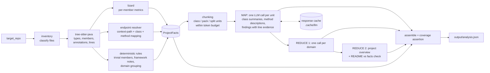

# codebase-analyzer

Structured knowledge extraction from a Java/Spring codebase with an LLM (via LangChain), within per-request token limits.

The target is [codejsha/spring-rest-sakila](https://github.com/codejsha/spring-rest-sakila): a Spring Boot 3 / Java 17 REST API over MySQL's Sakila DVD-rental database (Spring Web, Data JPA, HATEOAS, REST Docs, Lombok, Querydsl, MapStruct, Actuator). The output is one JSON document with a project overview, REST endpoints, functional domains, every class and method with signatures and descriptions, complexity metrics, and noteworthy findings with file/line evidence.

**Deliverables**

| What | Where |
|---|---|
| Source | `src/codebase_analyzer/` |
| Tests (no network) | `tests/` |
| Analysis from a real run | [`output/analysis.json`](output/analysis.json) |
| JSON Schema of the output | [`output/analysis.schema.json`](output/analysis.schema.json) |

**Core principle: facts are extracted, interpretation is generated.** Everything checkable (signatures, annotations, line ranges, endpoints, complexity, domain grouping) comes from deterministic parsing. The LLM only writes descriptions, summaries and findings, grounded in code it was shown. Every LLM-written field is labeled (`description_source`, `summary_source`, `source`).

---

## Setup

Requirements: Python 3.11+, [uv](https://docs.astral.sh/uv/), git. No Java, Gradle or MySQL needed: the Spring app is never built or run.

**Windows (PowerShell)**

```powershell
powershell -ExecutionPolicy ByPass -c "irm https://astral.sh/uv/install.ps1 | iex"   # install uv
git clone <this repo> codebase-analyzer; cd codebase-analyzer
uv sync
git clone https://github.com/codejsha/spring-rest-sakila target_repo
git -C target_repo checkout 62873f7bb8a06681f299f8bd209cb88089e9be04   # the commit analyzed in output/
Copy-Item .env.example .env    # then edit .env and set GOOGLE_API_KEY
```

**macOS / Linux**

```bash
curl -LsSf https://astral.sh/uv/install.sh | sh
git clone <this repo> codebase-analyzer && cd codebase-analyzer
uv sync
git clone https://github.com/codejsha/spring-rest-sakila target_repo
git -C target_repo checkout 62873f7bb8a06681f299f8bd209cb88089e9be04
cp .env.example .env           # then edit .env and set GOOGLE_API_KEY
```

**Gemini API key.** Create one at <https://aistudio.google.com/apikey> (Google account, no billing needed for the free tier) and put it in `.env` as `GOOGLE_API_KEY=...`. `.env` and `target_repo/` are gitignored. The key is read by the Google SDK from the environment and is never logged or written to output.

## Usage

```bash
uv run codebase-analyzer estimate --repo ./target_repo                       # plan + call/token estimate, no LLM calls
uv run codebase-analyzer analyze  --repo ./target_repo --output output/smoke.json --max-classes 5   # smoke run
uv run codebase-analyzer analyze  --repo ./target_repo --output output/analysis.json               # full run
uv run codebase-analyzer validate output/analysis.json --repo ./target_repo  # schema + coverage re-check
uv run codebase-analyzer schema   --output output/analysis.schema.json       # export the JSON Schema
uv run pytest                                                                 # tests (no network)
```

Useful options: `--max-classes N` (analyze N source files, picked round-robin across domains; facts are still emitted for all), `--model`, `--provider google_genai|anthropic`, `--concurrency`, `--request-tokens`, `--output-reserve`, `--no-cache`, `estimate --native-count` (checks the local token estimate against Gemini's `count_tokens`).

Configuration via `.env` / environment: `LLM_PROVIDER` (default `google_genai`), `LLM_MODEL` (default `gemini-3.5-flash-lite`), `LLM_TEMPERATURE` (default `0`), `LLM_CONCURRENCY` (default `1`). An optional Anthropic provider is available with `uv sync --extra anthropic`, `LLM_PROVIDER=anthropic` and `ANTHROPIC_API_KEY`. It is kept for portability but was not used for the delivered output.

## Architecture



| Module | Role |
|---|---|
| `inventory.py` | Walks the repo; `src/main/java` is analyzed, build/config files and README are project context, tests are listed only. Every skipped file has a reason. |
| `java_parser.py` | tree-sitter-java: packages, imports, nested types, records, enums, fields, methods/constructors, generics, annotations with arguments, line ranges. |
| `metrics.py` | lizard per member (cyclomatic complexity, NLOC, token count). |
| `endpoints.py` | `server.servlet.context-path` + class `@RequestMapping` + method mapping → HTTP method and path. |
| `deterministic.py`, `grouping.py` | Trivial-member templates, Lombok/MapStruct/Spring Data notes, domain = package segment below the base package. |
| `facts.py` | Builds the single `ProjectFacts` object with stable member ids. |
| `chunking.py`, `tokens.py` | Builds LLM units that fit the budget (see *Token management*). |
| `prompts.py` | Versioned prompts (`PROMPT_VERSION`). |
| `llm.py`, `cache.py` | LangChain model, structured output, validation, retries/backoff, on-disk cache. |
| `analyze.py` | Map → reduce orchestration; pack retry; split merge; budgeted reduce. |
| `assemble.py`, `schema.py` | Pydantic output schema, deterministic findings, coverage assertion. |
| `cli.py` | `estimate`, `analyze`, `validate`, `schema`. |

## Design decisions

**Deterministic facts vs LLM interpretation.** An LLM can misquote a signature, invent an endpoint, or skip a method. A parser can't. So everything that can be checked is extracted with tree-sitter and lizard, and the LLM is only asked for what a parser can't produce: what a method *does*, what a class is *for*, and what a reviewer would flag. Each LLM response is keyed by ids we supply (`m3`, `FilmController`) and attached to the facts by id. The model never produces the structure itself. This is also why the output can be validated: `verify_coverage` asserts every parsed type and member appears exactly once.

**One class per call, small classes packed.** One class per call gives the model the whole class (fields, collaborators, sibling methods) without unrelated code. Pure per-method calls would lose that context and cost ~3× more calls. Most of this repo is small DTOs, mappers and repositories, so small *and* simple classes (≤1,500 est. tokens, max CC ≤5) from the same domain *and* package are packed up to 8 per call. Packing never mixes packages, so a pack stays thematically coherent. The validator requires one record per class and one description per requested method. A class missing from a pack answer is retried on its own. Pack membership is recorded in `coverage.packs`.

**Trivial members get no LLM call.** Getters/setters, field-assigning or `super(...)` constructors, one-line delegations to an injected collaborator, `toString`/`equals`/`hashCode`, and empty bodies are detected by regex over the parsed body. They get a templated description, `trivial: true` and `description_source: "deterministic"`. Abstract members whose behavior is defined elsewhere are templated too: MapStruct mappings, Spring Data derived queries, and interface methods implemented by a project class. In this repo that removes 330 of 608 members from the LLM workload.

**Generated or inherited code is never invented.** Lombok-generated accessors/constructors, MapStruct implementations, Spring Data's inherited CRUD methods and Querydsl Q-classes aren't in the source tree. They're recorded as `framework_notes` on the class, not as methods.

**What LangChain does here** (deliberately narrow): a provider-neutral chat model (`ChatGoogleGenerativeAI`, optionally `ChatAnthropic`), `with_structured_output(PydanticModel, method="json_schema")` so Gemini decodes against our JSON Schema, provider-neutral error classes (`ModelRateLimitError`, …) for retry decisions, and `get_num_tokens` for native token counts. Orchestration (map/reduce, budgets, caching, retries) is plain Python, so every step is visible, testable with a fake chat model, and easy to step through.

**Why tree-sitter + lizard.** tree-sitter-java is a real, error-tolerant grammar with exact byte/line positions, which suits annotations, generics, records and nested types. lizard is a standard, language-agnostic complexity tool. Its whole-file Java parsing was observed to drop functions in some files, so each member is measured on its own inside a wrapper class, which makes the join with the parser exact.

**Why not a single prompt, RAG, or agents.** The task is *exhaustive* extraction: every method needs an entry.
- A single prompt doesn't fit (≈380 KB of Java ≈ 130k tokens), and even with a large context window, long-context recall for "describe all 608 members" is uneven and unverifiable.
- RAG retrieves the top-k *relevant* chunks for a question. That suits Q&A, not completeness: nothing guarantees every class is visited.
- An agent decides for itself what to read. That's nondeterministic coverage and costs more calls. Here, the deterministic plan *is* the coverage guarantee.

Map → reduce over a fixed plan visits everything exactly once, and the coverage check proves it.

## Token management

Every request must fit `request_tokens` (default 32,000):

```
input_limit = request_tokens − output_reserve (12,000) − 10% safety margin  = 16,800 tokens
```

The input part is the system prompt, the JSON schema of the expected answer, and the user prompt (code with line numbers, the list of requested keys, and bounded supporting context). The output reserve is also sent as the model's max output tokens, so a response can't silently overrun it.

- **Counting.** Planning uses a conservative local estimate, `ceil(chars / 3.0)`. Java averages ~3.5–4 characters per token, so this over-counts. It is deterministic and offline: the same repo always produces the same plan, which keeps cache keys stable. `estimate --native-count` checks it against Gemini's `count_tokens` (through LangChain's `get_num_tokens`) and reports the worst provider/estimate ratio, which must stay below 1.
- **Supporting context.** Signatures of project types referenced by the class (not their bodies), most-referenced first, capped at 2,000 tokens. Whatever doesn't fit is named as "referenced but not shown". If a class plus its context is over budget, the context is dropped first.
- **Splitting.** A class that still doesn't fit is split at member boundaries. Every part repeats a *skeleton*: package, imports, annotations, fields, and one placeholder line per member with its signature and line range. Each part therefore sees the whole class shape with exact line numbers. A single member larger than a part is cut into labeled line segments (`segment 2/3, lines 40-80`), and the prompt says only part of the body is shown. Nothing is truncated: the tests assert that every member line appears exactly once across parts. Split parts are merged back, and splits are recorded in `coverage.units_split`. (No file in this repo needs a split at the default budget. `--request-tokens 8000` shows it.)
- **Reduce inputs are budgeted too** (`reduce_input_tokens`, 16,000). Domain and project prompts are built from the class *summaries*, not code. If a domain's summaries exceed the budget, they're summarized in groups first (hierarchical reduce, at most 3 rounds).
- **Never truncate.** A file that can't be planned even after splitting is reported in `coverage.units_failed`. It is never cut down silently.

## Output JSON

Top-level sections (Pydantic models in `schema.py`; JSON Schema in `output/analysis.schema.json`):

| Section | Content | Source |
|---|---|---|
| `metadata` | `repo_url`, `commit_sha`, `analyzed_at`, `schema_version`, `prompt_version`, `provider`, `model`, `temperature`, `token_budget` (incl. `input_limit`), `packing`, `context_path`, `usage` (`llm_calls`, `input_tokens`, `output_tokens`, `cache_hits`), `max_classes` | run |
| `project_overview` | `purpose`, `functionality`, `architecture`, `technologies`, `cross_cutting_concerns`, `status` | LLM (reduce 2) |
| `endpoints` | `http_method`, `path`, `controller`, `handler_method`, `file`, `line`, `security`, `unresolved` | deterministic |
| `domains` | `name`, `summary`, `key_responsibilities`, `classes`, `endpoints`, `status` | grouping deterministic, text LLM (reduce 1) |
| `classes[]` | `fqn`, `kind`, `domain`, `file`, line range, `modifiers`, `annotations`, `extends`, `implements`, `fields`, `enum_constants`, `framework_notes` (facts) + `summary`, `responsibilities`, `summary_source`, `analysis_unit` | mixed, labeled |
| `classes[].methods[]` | `id`, `name`, `kind`, `signature`, `modifiers`, `annotations`, `parameters`, `return_type`, `line_start`/`line_end`, `has_body`, `trivial`, `complexity` {`cyclomatic`, `nloc`, `parameter_count`, `token_count`, `band`} (facts) + `description`, `description_source` ∈ `deterministic` / `llm` / `failed` / `not_analyzed` | mixed, labeled |
| `complexity_summary` | `avg_cyclomatic`, `avg_nloc`, `max_cyclomatic`, `max_nloc`, `band_counts`, `top_complex_methods`, `top_complex_trivial_methods`, `thresholds` | deterministic |
| `findings[]` | `category`, `severity`, `title`, `detail`, `scope` (class FQN, `domain:<name>` or `project`), `evidence` [{`file`, `line_start`, `line_end`}], `source` ∈ `llm` / `deterministic` | labeled |
| `coverage` | files discovered/analyzed/skipped (with reasons), classes/methods totals, `methods_described` (+ by source), `methods_undescribed`, `units_total`, `packs`, `units_split`, `units_failed` (with errors), `findings_dropped` | run |

A method id looks like `com.example.app.services.catalog.controller.ActorController#getActorFilmList(Integer,String,String,String,Pageable)@L90`. It is stable for a given commit and unique even for overloads.

LLM findings are checked before acceptance. Class-level evidence lines must lie inside the file. Reduce-level evidence must cite a file that was in the prompt. Anything that fails is listed in `coverage.findings_dropped`, never silently kept.

## Complexity

| Metric | Definition | Tool |
|---|---|---|
| `cyclomatic` | McCabe cyclomatic complexity: 1 + decision points (`if`, loops, `case`, `catch`, `&&`, `\|\|`, `?:`) | lizard |
| `nloc` | Non-comment, non-blank lines of code | lizard |
| `token_count` | Lexical tokens in the member | lizard |
| `parameter_count` | Declared parameters (varargs counted once) | parser |

Bands (`complexity_thresholds`): **low** CC 1–5, **moderate** 6–10, **high** 11–20, **very_high** ≥ 21. This follows the common McCabe/SEI reading: up to 10 is simple, 11–20 moderately risky, above 20 complex. Abstract declarations have no body and no metrics. `top_complex_methods` excludes trivial members. Hand-written `equals()` methods dominate raw CC in this repo (CC 10–16), so they're ranked separately in `top_complex_trivial_methods` and don't crowd out business logic. Members of anonymous classes inside a method aren't folded into that method's CC.

## Caching, retries, reproducibility

- **Cache.** Every validated response is stored in `.cache/llm/` under a SHA-256 key over everything that can change the answer: `PROMPT_VERSION`, provider, model, temperature, output schema, system prompt, and the full user prompt (which includes the code). A changed class, prompt or model is a cache miss. Unchanged units replay without a call. Writes are atomic and happen as each response arrives.
- **Resume.** Because of that, an interrupted run (Ctrl-C, crash, quota) resumes by re-running the same command.
- **Rate limits (free tier).** Default concurrency is 1. Errors are handled by type:

  | Error | Handling |
  |---|---|
  | 429 / `RESOURCE_EXHAUSTED`, 5xx, timeouts | Exponential backoff (10 s doubling to 120 s, up to 8 retries). Gemini's `retryDelay` hint is used when present. SDK retries are disabled so there is exactly one policy. |
  | Daily-quota 429 (`…PerDay…`) | Stops the run and prints the exact resume command. Quotas reset at midnight Pacific time. |
  | Auth / permission / unknown model | Fails fast. |

- **Invalid output.** A response that is unparseable or fails local validation (wrong keys, a missing method, a missing class) is re-sent up to 3 times with the validation error appended. After that it's reported in `coverage.units_failed`, and the affected methods get `description_source: "failed"`. Nothing is fabricated.
- **Reproducibility.** Versioned prompts, a deterministic plan, the commit SHA and the *applied* temperature in metadata (temperature 0 where the model accepts it). Sampling settings don't make an LLM bit-for-bit deterministic anyway, so exact replay comes from the cache: re-running with the same cache reproduces the same JSON content.

## Model choice

**Gemini 3.5 Flash-Lite (`gemini-3.5-flash-lite`) on the Gemini API free tier.**

The plan was Gemini 3.8 Flash. Its free tier turned out to allow only **20 requests per day**: the second smoke run got `429 RESOURCE_EXHAUSTED … limit: 20`. The full analysis needs ~120 calls, so it switched to Flash-Lite, which has a separate free-tier quota.

Comparison on the same 5 smoke-test classes:

| | 3.8 Flash | 3.5 Flash-Lite |
|---|---|---|
| Method descriptions correct | 6/6 | 6/6 (1 omits a step: `userLogin` doesn't mention `securityService.authenticateToken`) |
| Class-level findings | 6 (4 valid: locale-sensitive `toLowerCase()`, missing `@Valid` on the login body, constants class without a private constructor, redundant `toCollectionModel` override) | 0 |

Descriptions are about as accurate, but Flash-Lite reviews much less deeply, so the findings in `analysis.json` are sparse. A paid tier with a stronger model is the obvious upgrade.

The model is configuration (`LLM_MODEL`, `--model`), and the provider is too (`LLM_PROVIDER`). Changing either invalidates the cache automatically.

**Temperature.** Temperature 0 is the configured default and is sent to models that accept it. Gemini 3.5 Flash-Lite uses fixed sampling and ignores temperature (langchain-google-genai drops it with a warning). So the analyzer doesn't send it to that model, and the metadata records `temperature: null` with a `temperature_note`, not a value that wasn't applied.

## Assumptions

- The analyzed code is `src/main/java`. Tests are listed but not described. Build files, `application*.yaml` (secret-like values masked) and the README feed only the project overview.
- Domains follow the package convention `com.example.app.services.<domain>...` (catalog, customer, rental, …). Packages directly under the base package (`common`, `config`) are their own groups, and the application class is `application`.
- The README is a *claim*: where it disagrees with the extracted facts, the facts win and the mismatch is reported as a `documentation_mismatch` finding.
- "Key methods" means every non-trivial method gets an LLM description, and trivial ones are kept but templated. Importance ranking is left to consumers (complexity, endpoints and findings are all available for that).

## Limitations

- **No full symbol resolution or call graph.** Types are matched by simple name, and supporting context is "signatures of project types this file mentions". A method's description is based on its own class plus those signatures, not on transitive callees.
- **Generated code is not analyzed.** Lombok, MapStruct and Querydsl Q-classes only exist after a build. They're noted, not described.
- **The database layer is out of scope.** The Sakila views, stored procedures and triggers live in MySQL, not in this repository, so behavior that depends on them is invisible.
- **README claims vs code.** Only endpoint/CRUD claims are checked deterministically. Other mismatches depend on the LLM noticing them.
- **LLM nondeterminism.** Descriptions can vary between uncached runs even at temperature 0. They are grounded but not verified line by line; see the evaluation below for measured accuracy.
- **Heuristic trivial detection.** Regex over normalized bodies is conservative. A borderline method goes to the LLM rather than getting a wrong template.
- **Free-tier data use.** On the Gemini API free tier, Google may use prompts and responses to improve its products. That's fine for this public repository, but don't send private code on the free tier: use a paid tier or another provider.

## Future work

- **Incremental analysis for large repos.** Key the cache per class content hash (already true), diff against the last analyzed commit, and re-run only changed units plus the reduces they feed.
- **RAG Q&A layer** over `analysis.json` plus code chunks, for questions like "where is rental pricing computed?". That's complementary to the exhaustive extraction here.
- **Local models for private code** (e.g. through Ollama with LangChain). The provider boundary is one function in `llm.py`.
- **JavaParser symbol resolution** for a real call graph and cross-class context, instead of simple-name matching.
