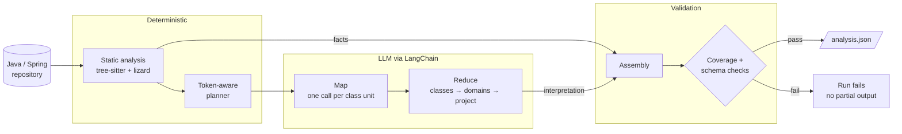

<div align="center">

# Codebase Analyzer

**Parser-grounded analysis of Java/Spring codebases, with LLM interpretation and schema-validated output.**

[](https://github.com/Madhav-29/codebase-analysis-using-llm/actions/workflows/ci.yml)


[](LICENSE)

[Results](#-evaluation-results) · [Architecture](#️-architecture) · [Quick Start](#-quick-start) · [Output](#output-contract) · [Decisions](#engineering-decisions) · [Limitations](#known-limitations) · [Docs](#documentation)

</div>

---

Codebase Analyzer is a Python CLI that reads a Java/Spring repository and writes **one schema-validated JSON document**. The document covers the project architecture, documentation for every method, REST endpoints, functional domains, complexity metrics, and findings backed by file and line evidence.

> **Design principle:** *deterministic tools establish facts; LLMs provide interpretation.*
>
> Parsers decide which classes, methods, signatures, routes, and complexity metrics exist. The LLM writes only descriptions, summaries, and findings. Every generated field records where it came from, is checked against a strict schema, and is assembled only after the coverage checks pass.

Built as a take-home engineering assignment and evaluated on [spring-rest-sakila](https://github.com/codejsha/spring-rest-sakila), a Java 17 / Spring Boot 3 application.

## 📊 Evaluation Results

**Target:** `spring-rest-sakila` @ `62873f7` &nbsp;·&nbsp; **Model:** GPT-5.4-mini (`gpt-5.4-mini-2026-03-17`) via Azure AI Foundry

<table>
<tr>
<td align="center"><h3>608 / 608</h3>methods documented</td>
<td align="center"><h3>0</h3>false positives in 34<br/>reviewed serious findings</td>
<td align="center"><h3>14 / 15</h3>verified defects detected<br/>(+1 partial)</td>
<td align="center"><h3>3m 45s</h3>end-to-end run</td>
</tr>
</table>

| Area | Metric | Result |
|---|---|---|
| **Coverage** | Source files / classes | 188/188 files, 248/248 classes |
| | Methods documented | **608/608 (100%)**: 278 by the LLM, 330 by rules |
| **Extraction** | REST endpoints / functional domains | 70 / 11 |
| | Key methods / findings | 161 / 323 |
| **Execution** | LLM requests | 123 (120 live, 3 cached), **0 failures** |
| | Tokens | 306k input / 75k output |
| **Quality** | Description accuracy (12 reviewed) | 10 correct, 2 partial, 0 incorrect |
| | Serious-finding precision (34 reviewed) | 0 false positives |
| | Verified defect recall | 14/15 detected, plus 1 partial |

> [!NOTE]
> These numbers come from one repository and a limited manual review. They are not a claim of accuracy on arbitrary Java projects. Token counts are reported without price estimates. The methodology, the baseline comparison, and the caveats are in [docs/evaluation.md](docs/evaluation.md).

**Generated artifacts:** [analysis.json](output/analysis.json) · [readable report](output/analysis_report.md) · [Gemini 3.5 Flash-Lite baseline](output/baselines/)

## 🏗️ Architecture

The pipeline has three stages: source extraction, LLM inference, and output validation. Each stage can be tested on its own.



<details>
<summary><b>1. Deterministic source analysis</b>: tree-sitter and lizard establish the facts</summary>

<br/>

[tree-sitter](https://tree-sitter.github.io/) extracts Java syntax and [lizard](https://github.com/terryyin/lizard) measures complexity. Together they are the source of truth for:

- classes, methods, signatures, and source locations
- Spring REST endpoint mappings
- cyclomatic complexity and non-comment lines of code
- rule-based findings and method classification

Framework-defined and trivial methods are documented by deterministic rules, so they never reach the model. On the evaluated repository, that covered **330 of 608 methods**. The model is never the authority on which methods, endpoints, or source locations exist.

</details>

<details>
<summary><b>2. Token-aware planning</b>: class-level units that fit the budget without truncation</summary>

<br/>

Source code is grouped into class-level analysis units before any inference. The planner:

- works to a configurable per-request token budget
- reserves room for the model's output plus a safety margin
- packs small classes together into one request
- splits large classes at method boundaries
- keeps full coverage without truncating any source

A class gives a method enough context to describe it well while keeping the cost of each call low. The token estimate is conservative, is the same for every provider, and has been checked against native tokenizers. See [Token management](docs/architecture.md#token-management).

</details>

<details>
<summary><b>3. LangChain orchestration</b>: hierarchical Map → Reduce with strict structured output</summary>

<br/>

LangChain is the model integration layer. Responses are generated through `with_structured_output`, decoded into strict schemas, and validated locally.

- **Map:** each bounded unit of source produces method descriptions, a class summary, and candidate findings.
- **Reduce:** class summaries are combined into functional-domain summaries, and those into a project-level overview.

Provider code is kept separate from analysis code, so models can be compared without touching the extraction pipeline.

</details>

<details>
<summary><b>4. Validated assembly</b>: fail-closed coverage with provenance on every generated field</summary>

<br/>

Deterministic facts and LLM interpretations are merged into a versioned output schema. Validation checks the structure and the method coverage. **If any method lacks documentation, the run fails** instead of quietly writing an incomplete result.

Every description and finding records its source (`deterministic` or `llm`), so a consumer can tell parser-derived and rule-based content apart from model interpretation.

</details>

Modules, dependency rules, and token management are covered in [docs/architecture.md](docs/architecture.md).

## 🚀 Quick Start

**Prerequisites:** Python 3.11+, [uv](https://docs.astral.sh/uv/), and Git. The target application is only read, never built or run.

```bash
git clone https://github.com/Madhav-29/codebase-analysis-using-llm.git
cd codebase-analysis-using-llm
uv sync --extra azure

# Target repository, pinned to the evaluated commit
git -c core.longpaths=true clone https://github.com/codejsha/spring-rest-sakila ../spring-rest-sakila
git -C ../spring-rest-sakila checkout 62873f7bb8a06681f299f8bd209cb88089e9be04

cp .env.example .env   # PowerShell: Copy-Item .env.example .env
```

Set up `.env` for your provider:

<details open>
<summary><b>Azure AI Foundry</b> (default)</summary>

```dotenv
AZURE_AI_ENDPOINT=https://<resource>.services.ai.azure.com/openai/v1
LLM_MODEL=<deployment-name>
AZURE_AI_API_KEY=<api-key>   # leave empty to authenticate with `az login`
```

</details>

<details>
<summary><b>Google Gemini</b></summary>

```dotenv
LLM_PROVIDER=google_genai
LLM_MODEL=gemini-3.5-flash-lite
GOOGLE_API_KEY=<api-key>     # free at https://aistudio.google.com/apikey
```

</details>

Provider-specific setup is in [docs/operations.md](docs/operations.md).

Then run it:

```bash
uv run codebase-analyzer estimate --repo ../spring-rest-sakila   # request and token estimate, no LLM calls
uv run codebase-analyzer analyze  --repo ../spring-rest-sakila   # full run → output/analysis.json
```

<details>
<summary><b>Full command reference</b></summary>

<br/>

| Command | Purpose |
|---|---|
| `estimate --repo <path>` | Estimate request volume and token usage without calling the LLM |
| `analyze --repo <path> --max-classes 5 --output output/smoke/analysis.json` | Smoke test on a small subset |
| `analyze --repo <path>` | Analyze the whole repository and write `output/analysis.json` |
| `validate output/analysis.json --repo <path>` | Check the schema and confirm every method is documented |
| `report` | Write the readable `output/analysis_report.md` |
| `eval output/analysis.json --repo <path>` | Generate an evaluation review sheet |

Prefix each command with `uv run codebase-analyzer`. To run the offline test suite (73 tests, no credentials needed):

```bash
uv run pytest
```

CI runs `ruff check`, `ruff format --check`, `mypy`, and `pytest` on Ubuntu and Windows.

</details>

## How the Assignment Is Met

| Requirement | Mechanism | Where |
|---|---|---|
| Read and process the codebase efficiently | tree-sitter parsing and lizard metrics; 330 trivial and framework-defined methods never reach the LLM | [`analysis/`](src/codebase_analyzer/analysis/) |
| Feed code to the LLM within token limits | Per-request budget with reserved output and a margin; small classes packed, large ones split at method boundaries; nothing truncated | [`planning/`](src/codebase_analyzer/planning/), [`config.py`](src/codebase_analyzer/config.py) |
| Choose a suitable LLM | GPT-5.4-mini, chosen over Gemini 3.5 Flash-Lite by measurement on identical prompts | [`llm/providers/`](src/codebase_analyzer/llm/providers/), [evaluation](docs/evaluation.md) |
| Use LangChain or LlamaIndex | LangChain chat models, `with_structured_output` (strict JSON schema), provider-neutral error types | [`llm/`](src/codebase_analyzer/llm/) |
| High-level overview | Reduce: class summaries → domain summaries → project overview | [`reduce_stage.py`](src/codebase_analyzer/pipeline/reduce_stage.py) |
| Key methods, signatures, descriptions | Signatures from the parser, descriptions from the LLM, plus a rule-based `key_methods` index | [`key_methods.py`](src/codebase_analyzer/analysis/key_methods.py) |
| Complexity and noteworthy aspects | Per-method cyclomatic complexity and NLOC with bands; findings cite file and lines; rule-based checks run as well | [`metrics.py`](src/codebase_analyzer/analysis/metrics.py), [`checks.py`](src/codebase_analyzer/analysis/checks.py) |
| Consistent, machine-readable JSON | Pydantic models and a versioned JSON Schema; strict decoding plus local validation; the run fails if any method is missing | [`schema/`](src/codebase_analyzer/schema/), [JSON Schema](schemas/analysis.schema.json) |

## Output Contract

The main artifact, [`output/analysis.json`](output/analysis.json), is checked with Pydantic and a versioned [JSON Schema](schemas/analysis.schema.json).

| Section | Contents | Source |
|---|---|---|
| `metadata` | Configured and served model, schema version, run statistics | Runtime |
| `project_overview` | Architectural overview | LLM (reduce) |
| `key_methods` | Important methods, selected by deterministic criteria | Parser + rules |
| `endpoints` | Spring REST mappings | Parser |
| `domains` | Functional-domain summaries | LLM (reduce) |
| `classes[].methods[]` | Complete method inventory with descriptions | Parser + LLM/rules |
| `complexity_summary` | Complexity metrics and distributions | lizard |
| `findings` | Findings with file and line evidence | LLM + rules |
| `coverage` | How complete extraction and documentation are | Validator |

<details>
<summary><b>Example output</b> (abbreviated)</summary>

```json
{
  "metadata": {
    "model": "gpt-5.4-mini",
    "served_models": ["gpt-5.4-mini-2026-03-17"],
    "reasoning_effort": "low",
    "schema_version": "1.1"
  },
  "key_methods": [
    {
      "id": "com.example.app.services.rental.service.RentalServiceImpl#rentDvd(RentalDto.RentalCreateRequest)@L63",
      "signature": "public RentalDto.Rental rentDvd(RentalDto.RentalCreateRequest model)",
      "description": "Checks inventory availability for the requested store and film, validates customer and staff existence, saves a new rental, then creates a payment for the rental and returns the saved rental as a DTO.",
      "description_source": "llm",
      "reasons": ["service_api"],
      "cyclomatic": 2
    }
  ],
  "findings": [
    {
      "category": "security",
      "severity": "high",
      "title": "Created tokens have no expiration",
      "scope": "com.example.app.common.security.JwtTokenProvider",
      "evidence": [
        {
          "file": "src/main/java/com/example/app/common/security/JwtTokenProvider.java",
          "line_start": 35,
          "line_end": 39
        }
      ],
      "source": "llm"
    }
  ]
}
```

</details>

## Engineering Decisions

The implementation puts correctness, bounded inference, and reproducibility ahead of agent autonomy.

| Decision | Rationale | Record |
|---|---|---|
| **Parser-grounded facts** | The LLM cannot invent structure | [ADR 0001](docs/adr/0001-deterministic-facts-llm-interpretation.md) |
| **LangChain over LlamaIndex** | The job is exhaustive structured extraction, not retrieval | [ADR 0002](docs/adr/0002-langchain-over-llamaindex.md) |
| **Class-level units with packing** | Keeps local context while controlling token cost | [ADR 0003](docs/adr/0003-class-level-units-and-packing.md) |
| **Measured model selection** | Identical prompts and documented criteria, not preference | [ADR 0004](docs/adr/0004-model-selection.md) |
| **Content-addressed cache** | Runs can resume, replays are exact, unchanged inference is reused | [ADR 0005](docs/adr/0005-content-addressed-cache.md) |
| **Hierarchical Map → Reduce** | Covers every method and still produces a project-level summary | [Architecture](docs/architecture.md#pipeline) |
| **Strict structured output** | LLM responses can be processed deterministically downstream | [Architecture](docs/architecture.md#output) |
| **Fail-closed coverage** | Large repositories cannot have methods silently dropped | [Architecture](docs/architecture.md#output) |

> [!TIP]
> **Why not an autonomous agent?** This is a constrained workflow on purpose. Static analysis is deterministic, the stages are explicit, and the model has a narrow job. That makes failures easier to isolate, results easier to evaluate, and output easier to reproduce.

### Reliability and reproducibility

- **Content-addressed inference cache:** an interrupted run resumes without repeating finished calls, and a change that only affects output rebuilds with no new model calls.
- **Versioned schema:** the output contract is explicit and can be checked independently.
- **Fail-closed coverage checks:** an analysis with any undocumented method is rejected.
- **Model traceability:** the run records the model version that actually served it, not just the deployment name. This matters because cloud deployments can be upgraded automatically.
- **Offline testing:** 73 deterministic tests that need no credentials or network access.

## Model Evaluation

GPT-5.4-mini was chosen after a comparison with **Gemini 3.5 Flash-Lite** using the same prompts and criteria: description correctness, defect detection and finding quality, coverage and structured-output reliability, request volume and token use, and run behavior.

- **Descriptions:** of 12 manually reviewed, 10 were correct, 2 partially correct, and none incorrect.
- **Findings:** none of the 34 reviewed serious findings was a false positive. About 20% of them were style opinions rather than actionable defects.

These results support the chosen model for this workload. The sample is small and comes from one repository. Full details are in [docs/evaluation.md](docs/evaluation.md).

## Known Limitations

The tool is deliberately limited to static analysis of a single repository.

| Limitation | Impact |
|---|---|
| No symbol resolution or call graph | Descriptions rely on the class plus the signatures of referenced types |
| LLM interpretation is not formally verified | Descriptions and findings can be incomplete or wrong even when the JSON is valid |
| Limited manual review | 12 descriptions and 34 serious findings reviewed; 277 of the 320 LLM findings were not reviewed one by one |
| Generated code is not expanded | Lombok, MapStruct, and Querydsl output is identified but not analyzed |
| Runtime context outside the repository | Database procedures, views, and external behavior are out of scope |
| Bounded README validation | Rule-based checks cover only endpoint and CRUD claims |
| Source code leaves the machine | Code is sent to the configured provider; the evaluated Azure deployment uses the US data zone |
| Provider version drift | Automatic model upgrades can change results; the served version is recorded |
| Evaluated on one repository | How well it generalizes to other Java architectures and sizes is not measured |

## Roadmap

- [ ] **Incremental analysis:** reprocess only changed classes, reusing the content-addressed cache
- [ ] **Symbol-aware dependencies:** JavaParser symbol resolution for call graphs and reasoning across classes
- [ ] **Codebase Q&A:** a RAG layer over the source and `analysis.json`
- [ ] **Observability:** LangSmith or OpenTelemetry tracing for latency, tokens, failures, and per-stage diagnostics
- [ ] **Private deployment:** local models for code that must stay in-house
- [ ] **Broader evaluation:** more Java/Spring repositories and larger independently verified samples

## Documentation

| Document | Contents |
|---|---|
| [Architecture](docs/architecture.md) | Pipeline, modules, dependency rules, token management, output |
| [Evaluation](docs/evaluation.md) | Methodology, golden methods, precision and recall, model comparison |
| [Operations](docs/operations.md) | Provider setup and configuration |
| [ADRs](docs/adr/) | Architecture decision records 0001–0005 |
| [JSON Schema](schemas/analysis.schema.json) | Versioned output contract |

---

<div align="center">

Released under the [MIT License](LICENSE) · Built by Madhav Sai Avanigadda

</div>
