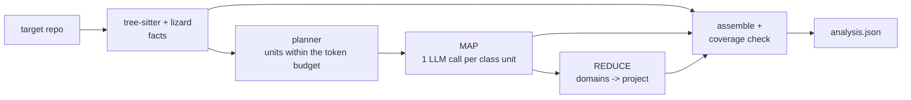

# codebase-analyzer

A command-line tool that analyzes a Java/Spring codebase with an LLM (through LangChain) and produces one validated JSON document:

- a project overview;
- key methods, plus every method's signature and description;
- REST endpoints and functional domains;
- complexity metrics;
- findings with file/line evidence.

Facts (signatures, routes, complexity, which methods exist) come from parsers. The LLM writes only descriptions, summaries and findings, and every LLM-written field is labeled. Built as a take-home assignment, with [codejsha/spring-rest-sakila](https://github.com/codejsha/spring-rest-sakila) (Spring Boot 3, Java 17) as the target.

**Results** on spring-rest-sakila @ `62873f7` with GPT-5.4-mini (`gpt-5.4-mini-2026-03-17`) on Azure AI Foundry:

| | |
|---|---|
| Coverage | 188/188 files, 248/248 classes, **608/608 methods described** (278 by the LLM, 330 by rules) |
| Extracted | 70 endpoints, 11 domains, 161 key methods, 323 findings |
| Run | 123 calls, 0 failures, 3 min 45 s, 306k input / 75k output tokens (prices not included) |
| Measured accuracy | 12 hand-checked descriptions: **10 correct, 2 partial, 0 incorrect**. 34 serious findings: **0 false positives**. **14 of 15** verified defects found (+1 partial). See [evaluation](docs/evaluation.md). |

The full output is in [`output/analysis.json`](output/analysis.json), with a readable [`output/analysis_report.md`](output/analysis_report.md). A Gemini 3.5 Flash-Lite baseline is in [`output/baselines/`](output/baselines).

## Quick start

Requires Python 3.11+, [uv](https://docs.astral.sh/uv/) and git. The Spring app is never built or run.

```bash
git clone https://github.com/Madhav-29/codebase-analysis-using-llm.git && cd codebase-analysis-using-llm
uv sync --extra azure
git -c core.longpaths=true clone https://github.com/codejsha/spring-rest-sakila ../spring-rest-sakila
git -C ../spring-rest-sakila checkout 62873f7bb8a06681f299f8bd209cb88089e9be04
cp .env.example .env            # Windows (PowerShell): Copy-Item .env.example .env
```

In `.env`, choose a provider (details in [operations](docs/operations.md)):

- **Azure AI Foundry (default):** `AZURE_AI_ENDPOINT=https://<resource>.services.ai.azure.com/openai/v1`, `LLM_MODEL=<deployment name>`, and `AZURE_AI_API_KEY`. Leave the key empty to use `az login` instead.
- **Gemini:** `LLM_PROVIDER=google_genai`, `LLM_MODEL=gemini-3.5-flash-lite`, and `GOOGLE_API_KEY` (free at <https://aistudio.google.com/apikey>).

```bash
uv run codebase-analyzer estimate --repo ../spring-rest-sakila                       # calls and tokens, no LLM calls
uv run codebase-analyzer analyze  --repo ../spring-rest-sakila --max-classes 5 --output output/smoke/analysis.json
uv run codebase-analyzer analyze  --repo ../spring-rest-sakila                       # full run -> output/analysis.json
uv run codebase-analyzer validate output/analysis.json --repo ../spring-rest-sakila  # schema + every method present
uv run codebase-analyzer report                                                       # -> output/analysis_report.md
uv run codebase-analyzer eval output/analysis.json --repo ../spring-rest-sakila      # evaluation review sheet
uv run pytest                                                                         # 73 tests, offline
```

## Architecture



Modules, dependency rules and token management are described in [docs/architecture.md](docs/architecture.md).

## How the assignment is met

| Requirement | Mechanism | Where |
|---|---|---|
| Read and process the codebase efficiently | tree-sitter parsing and lizard metrics. 330 trivial and framework-defined methods never reach the LLM. | `analysis/` |
| Feed code to the LLM within token limits | A per-request budget with reserved output and a margin. One class per call; small classes packed, large ones split at method boundaries. Nothing truncated. | `planning/`, `config.py` |
| Choose a suitable LLM | GPT-5.4-mini, chosen against Gemini 3.5 Flash-Lite by measurement on identical prompts | `llm/providers/`, [evaluation](docs/evaluation.md) |
| Use LangChain or LlamaIndex | LangChain chat models, `with_structured_output` (strict JSON schema), provider-neutral error types | `llm/` |
| High-level overview | Reduce: class summaries → domain summaries → project overview | `pipeline/reduce_stage.py` |
| Key methods, signatures, descriptions | Signatures from the parser, descriptions from the LLM, and a rule-based `key_methods` index | `analysis/key_methods.py` |
| Complexity and noteworthy aspects | Per-method cyclomatic complexity and NLOC with bands. Findings cite file and lines; rule-based checks run too. | `analysis/metrics.py`, `analysis/checks.py` |
| Consistent, machine-readable JSON | Pydantic models and a versioned JSON Schema. Strict decoding plus local validation; the run fails if any method is missing. | `schema/`, [`schemas/`](schemas/analysis.schema.json) |

## Design decisions

- **Facts from parsers, interpretation from the LLM.** Structure is verifiable; LLM text is labeled and measured. [ADR 0001](docs/adr/0001-deterministic-facts-llm-interpretation.md)
- **LangChain over LlamaIndex.** The job is exhaustive structured extraction, not retrieval. [ADR 0002](docs/adr/0002-langchain-over-llamaindex.md)
- **Class-level units with packing and splitting.** A class is the right context for a method, and the plan proves full coverage. [ADR 0003](docs/adr/0003-class-level-units-and-packing.md)
- **Token budgeting.** A conservative estimate that's the same for every provider, verified against native tokenizers; every model gets identical prompts. [Token management](docs/architecture.md#token-management)
- **Model selection by criteria and measurement.** GPT-5.4-mini over Gemini 3.5 Flash-Lite, with the trade-offs recorded. [ADR 0004](docs/adr/0004-model-selection.md)
- **Content-addressed cache.** Interrupted runs resume, output-only changes rebuild for free, and replays are exact. [ADR 0005](docs/adr/0005-content-addressed-cache.md)

## Output

Sections: `metadata`, `project_overview`, `key_methods`, `endpoints`, `domains`, `classes[].methods[]`, `complexity_summary`, `findings`, `coverage` ([details](docs/architecture.md#output)). An excerpt:

```json
{
  "metadata": {"model": "gpt-5.4-mini", "served_models": ["gpt-5.4-mini-2026-03-17"], "reasoning_effort": "low", "schema_version": "1.1"},
  "key_methods": [{
    "id": "com.example.app.services.rental.service.RentalServiceImpl#rentDvd(RentalDto.RentalCreateRequest)@L63",
    "signature": "public RentalDto.Rental rentDvd(RentalDto.RentalCreateRequest model)",
    "description": "Checks inventory availability for the requested store and film, validates customer and staff existence, saves a new rental, then creates a payment for the rental and returns the saved rental as a DTO.",
    "description_source": "llm", "reasons": ["service_api"], "cyclomatic": 2
  }],
  "findings": [{
    "category": "security", "severity": "high", "title": "Created tokens have no expiration",
    "scope": "com.example.app.common.security.JwtTokenProvider",
    "evidence": [{"file": "src/main/java/com/example/app/common/security/JwtTokenProvider.java", "line_start": 35, "line_end": 39}],
    "source": "llm"
  }]
}
```

## Limitations

- **No call graph or symbol resolution.** A description is based on its class plus the signatures of the types it references.
- **LLM output is measured, not guaranteed.**
  - 2 of 12 checked descriptions are only partially correct.
  - About 20% of the reviewed serious findings are style opinions.
  - 277 of the 320 LLM findings weren't individually reviewed.
- **Generated code is noted, not analyzed** (Lombok, MapStruct, Querydsl). Database views and procedures aren't in the repository.
- **The rule-based README check covers only endpoint and CRUD claims.**
- **Code leaves the machine.** It is sent to the LLM provider; this deployment processes it in the US data zone. Whether the model version can change depends on the deployment's upgrade policy, but every run records the served version.
- **Evaluated on one codebase.** Costs are reported as token counts; prices aren't estimated.

## Future work

- **Incremental analysis** for large repositories: re-analyze only changed classes, since the cache is already content-keyed.
- **A RAG Q&A layer** (LlamaIndex) over `analysis.json` and the code.
- **LangSmith or OpenTelemetry tracing.**
- **Local models** for private code.
- **JavaParser symbol resolution** for a real call graph.

License: [MIT](LICENSE).
