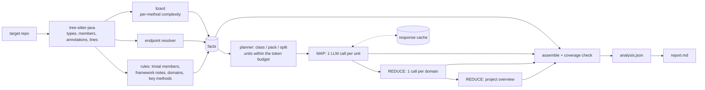
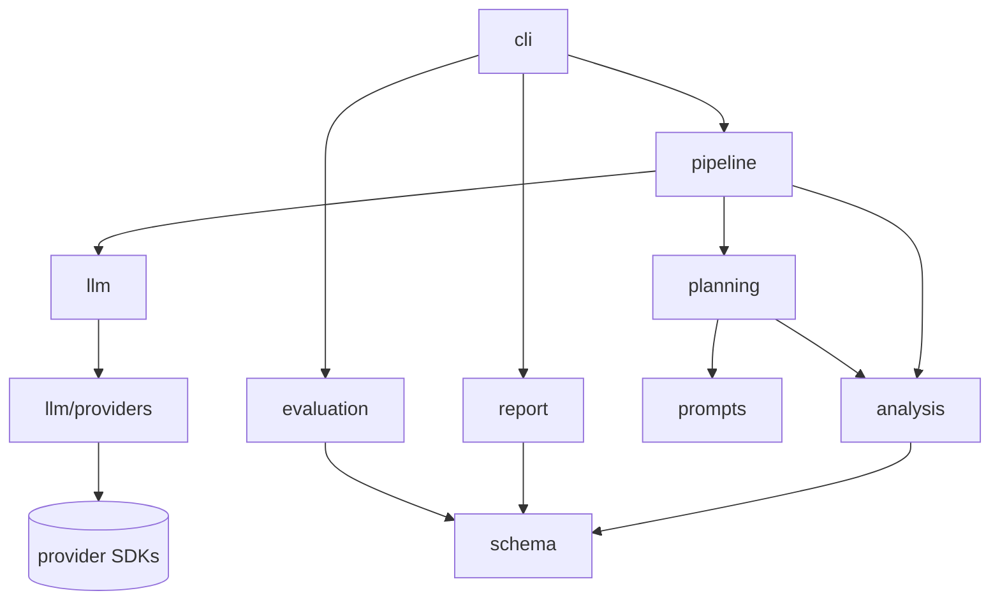

# Architecture

## Pipeline

1. **Read (`analysis/`).**
   - `inventory.py` classifies files: `src/main/java` is analyzed, build/config files and the README are context, and tests are listed.
   - `java_parser.py` (tree-sitter) extracts types, members, generics, annotations and line ranges.
   - `metrics.py` (lizard) measures each method.
   - `endpoints.py` resolves routes as context-path + class mapping + method mapping.
2. **Decide what needs the LLM (`analysis/rules.py`).**
   - Trivial members get templated descriptions: getters/setters, `equals`/`hashCode`/`toString`, field-assigning constructors, one-line delegations.
   - So do abstract members defined elsewhere: MapStruct mappings, Spring Data derived queries.
   - Lombok/MapStruct-generated and Spring Data-inherited methods become `framework_notes`; they are never invented.
   - 330 of 608 members are handled this way.
3. **Plan (`planning/`).** Class, pack and split units within the token budget ([ADR 0003](adr/0003-class-level-units-and-packing.md)).
4. **Map (`pipeline/map_stage.py`).** One structured call per unit. It returns a class summary, a description per requested method, and findings with line numbers, all keyed by ids the analyzer supplied.
5. **Reduce (`pipeline/reduce_stage.py`).**
   - Class summaries become domain summaries, and those become the project overview.
   - The overview also receives the build files, the config (with secrets masked) and the README, which is treated as a claim to check against the code.
   - Reduce inputs are budgeted and condensed in rounds when too large.
6. **Assemble (`pipeline/assemble.py`).** Facts and LLM text are joined by id, and the run fails if any parsed type or member is missing or duplicated.

`pipeline/run.py` holds this whole flow in one function, used by both the CLI and the integration tests.

## Modules and dependencies

**Dependencies point inward.**
- `analysis`, `planning`, `schema`, `prompts`, `report` and `evaluation` never import `llm` or `pipeline`.
- `llm` knows nothing about Java analysis.
- Provider SDKs are imported only in `llm/providers/`.
- `config` and `errors` are leaves imported by everyone.

`tests/unit/test_import_boundaries.py` enforces these rules by parsing every module's imports.

| Module | Responsibility |
|---|---|
| `cli.py` | Typer commands: `analyze`, `estimate`, `validate`, `schema`, `report`, `eval`. Configuration errors become one-line messages. |
| `config.py` | Settings from CLI flags over environment/`.env` over defaults, validated once. API keys are not settings. |
| `errors.py` | Errors that cross module boundaries: `ConfigError`, `ProviderAuthError`, `ProviderQuotaExhausted`, `CoverageError`. |
| `prompts.py` | Versioned prompt templates (`PROMPT_VERSION`, part of every cache key). |
| `analysis/` | Facts only: inventory, parser, metrics, endpoints, grouping, rules, key-method selection, rule-based checks. |
| `planning/` | Token estimate and unit planning (chunking, packing, splitting). |
| `llm/client.py` | Structured calls: cache, retries/backoff, error classification, validation, usage. |
| `llm/providers/` | Settings → LangChain chat model: `azure_foundry`, `google_genai`, `anthropic`. |
| `llm/cache.py` | Content-addressed response cache ([ADR 0005](adr/0005-content-addressed-cache.md)). |
| `pipeline/` | Map stage, reduce stages, assembly, and the end-to-end `run_analysis`. |
| `schema/` | `responses.py`: what the LLM must return (frozen, because its JSON Schema is part of every cache key). `output.py`: the `analysis.json` models. |
| `report.py`, `evaluation.py` | Markdown report and evaluation as code. Both deterministic, no LLM. |

## Token management

Every request fits `request_tokens (32,000) − output_reserve (12,000) − 10% margin = 16,800` input tokens. The output reserve is sent as the max output tokens, and it includes reasoning tokens.

- **Estimate.** Planning uses `chars / 3`: conservative, offline, and the same for every provider.
  - Native counts confirm it. The worst unit came in at 0.71 of its estimate with GPT's tokenizer (`o200k_base`), and 0.85 with Gemini's `count_tokens` (`estimate --native-count`).
  - On the real runs, class-stage input was 395k estimated vs 262k (GPT) and 253k (Gemini) actual.
- **Context.** Each class is sent with the signatures of the project types it references, capped at 2,000 tokens. That context is dropped first when a class is over budget.
- **Splitting.** At method boundaries, with a class skeleton in every part. A single huge method is cut into labeled line segments, and tests assert that no line is lost.
- **Reduce budget.** Reduce steps read summaries, not code, within 16,000 tokens; larger inputs are condensed in rounds.
- **No truncation.** Anything that can't fit is reported in `coverage.units_failed`.

## Output

`output/analysis.json` (JSON Schema: [`schemas/analysis.schema.json`](../schemas/analysis.schema.json), schema version 1.1):

| Section | Content |
|---|---|
| `metadata` | Repo, commit, timestamp, schema/prompt versions, provider, model, served model versions, applied temperature (or why it isn't sent), reasoning effort, token budget, usage (live vs cached; reasoning tokens) |
| `project_overview` | Purpose, functionality, architecture, technologies, cross-cutting concerns |
| `key_methods` | Endpoint handlers (with routes), public `@Service` methods, custom `@Repository` queries, complex methods, each with signature, description and reasons |
| `endpoints` | HTTP method, full path, controller, handler, file:line, security annotations |
| `domains` | Summary and responsibilities per functional area, with its classes and endpoints |
| `classes[].methods[]` | Signature, modifiers, annotations, parameters, return type, lines, `trivial`, complexity {cyclomatic, nloc, parameter_count, token_count, band}, `description` + `description_source` |
| `complexity_summary` | Averages, maxima, band counts, top complex methods (boilerplate ranked separately), thresholds |
| `findings[]` | Category, severity, title, detail, scope, evidence (file + lines), `source` (`llm` or `deterministic`) |
| `coverage` | Files analyzed/skipped (with reasons), totals, packs, splits, failed units, rejected findings |

**Complexity.** McCabe cyclomatic complexity and NLOC come from lizard. Bands: low < 6, moderate 6–10, high 11–20, very high ≥ 21. Hand-written `equals()` methods are the most complex code in this repository (CC up to 16), so they're ranked apart from business logic.

**Finding checks.**
- Evidence must cite real lines of a file the model was shown.
- LLM findings that repeat a rule-based one (same category and file) are dropped.
- Prompt keys echoed into prose (`m8`) are mapped back to method names.
- Rejected findings are listed in `coverage.findings_dropped`.
